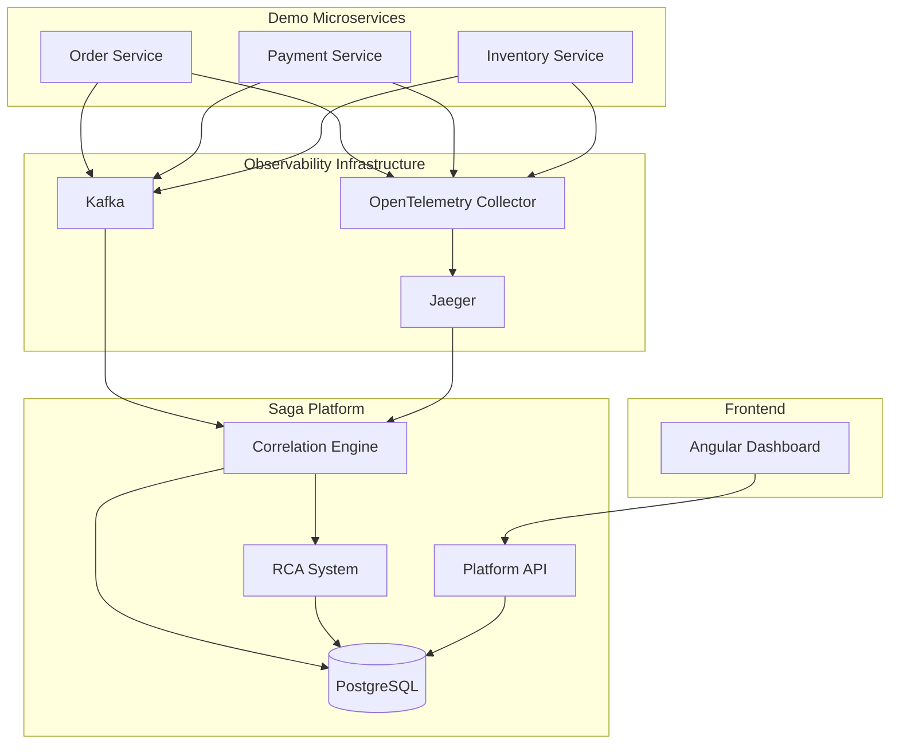

# Kế hoạch thực hiện đề tài KLTN: Nền tảng quan sát Saga cho microservices

## Tổng quan đề tài

Đề tài xây dựng một nền tảng quan sát (observability platform) chuyên biệt cho Saga pattern trong kiến trúc microservices. Nền tảng sẽ thu thập, phân tích và cung cấp khả năng debug cho các giao dịch phân tán, bao gồm:

- **Correlation Engine**: Liên kết các events từ nhiều services thành saga timeline
- **RCA System**: Phân tích nguyên nhân gốc rễ của lỗi (Root Cause Analysis)  
- **Dashboard**: Giao diện trực quan để theo dõi và debug saga instances
- **Demo System**: 3 microservices mô phỏng quy trình đặt hàng (Order-Payment-Inventory)

## Lịch trình tổng thể (9 tháng + 1 tháng buffer)

| Phase | Tháng tương đối | Nội dung chính | Viết thesis song song |
|-------|-----------------|----------------|-----------------------|
| Phase 1 | Tháng 1-2 | Nghiên cứu, thiết kế, 9 deliverables | Chương 1 + Chương 2 (bản nháp) |
| Phase 2 | Tháng 3-4 | Infrastructure, Demo Services | Chương 3 (bắt đầu) |
| Phase 3 | Tháng 5-6 | Correlation Engine | Chương 3 (hoàn thiện) |
| Phase 4 | Tháng 6-7 | RCA System | Chương 4 (bắt đầu) |
| Phase 5 | Tháng 7 | Platform API (song song Phase 4) | Chương 4 (tiếp tục) |
| Phase 6 | Tháng 8 | Angular Dashboard | Chương 4 (hoàn thiện) |
| Phase 7 | Tháng 9 | Testing & Evaluation | Chương 5 |
| Phase 8 | Tháng 10 | Hoàn thiện báo cáo KLTN | Chương 6 + review toàn bộ |
| Buffer | Tháng 11 | Sửa bản thảo theo phản hồi thầy, chuẩn bị bảo vệ | - |

**Ghi chú về timeline**:
- "Tháng 1" = tháng bắt đầu thực hiện đề tài (tùy theo lịch học kỳ của trường)
- Phase 4 và Phase 5 chồng nhau ở Tháng 7 — đây là thiết kế có chủ đích: Platform API (saga management) có thể bắt đầu ngay khi storage layer (Phase 3) xong, không cần đợi RCA hoàn chỉnh
- Nên nộp bản thảo cho thầy hướng dẫn cuối Tháng 10 để có thời gian sửa

---

## Đóng góp của đề tài

1. **Chuẩn hóa business events + correlation contract**: Định nghĩa schema cho business events (sagaId, stepName, status) và correlation contract (trace context propagation) để gom các event/traces thành saga timeline.
2. **Correlation engine với state machine validation**: Kiểm tra workflow/state machine và phát hiện anomaly (stuck, duplicate, out-of-order, missing completion) dựa trên workflow specification.
3. **Rule-based RCA có explainability**: RCA engine với 8-10 rules, output có root cause + evidence + suggestions + links tới events/traces, giúp developer hiểu nguyên nhân và hành động.
4. **Evaluation có ground truth**: Methodology với failure matrix, baseline comparison (Jaeger + manual logs), 3 metrics (accuracy, time-to-insight, overhead), tái lập được bằng Docker/Testcontainers/Toxiproxy.

## Kiến trúc tổng thể




## Phase 1: Nghiên cứu và thiết kế (Tháng 1-2)

### 1.1 Problem Framing (Tuần 1-2) ⭐ MỚI - BẮT BUỘC

**Mục tiêu**: Chốt vấn đề, scope, assumptions, non-goals để thầy ký hướng

**Problem Statement**:

- Debug saga khó vì: async events, nhiều services, nhiều traces rời rạc
- Tools hiện tại (Jaeger, logs) không "nói ngôn ngữ saga"
- Cần business-aware observability layer

**Scope (IN)**:

- 1 domain demo: Order Saga (Order → Payment → Inventory)
- 1 message broker: Apache Kafka
- 1 stack: Spring Boot + OpenTelemetry + Jaeger
- 6-12 failure scenarios có ground truth
- Rule-based RCA (không ML)

**Assumptions**:

- At-least-once delivery (duplicate có thể xảy ra)
- Eventual consistency (không ACID)
- Clock skew có thể có (≤ 5 giây)
- Services có thể crash giữa chừng
- Network có thể có delay/timeout

**Non-goals (OUT)**:

- Không tự healing/auto-remediation
- Không exactly-once delivery
- Không thay thế APM tools (Datadog, New Relic)
- Không production deployment thật (chỉ dev environment)
- **Note**: Demo theo choreography style, nhưng nền tảng thiết kế không phụ thuộc coordination style

**Deliverable**: `problem-statement-and-scope.md` (2-3 trang, thầy ký hướng) ✅

---

### 1.2 Nghiên cứu lý thuyết (Tuần 3-4)

**Đọc 20 tài liệu tham khảo**:

- Saga Pattern (3 docs)
- Distributed Tracing (4 docs)
- OpenTelemetry (7 docs)
- Fault Injection (3 docs)
- Spring Boot Observability (2 docs)
- Academic (1 doc: Dapper)

**Deliverable** (FLEXIBLE):

- `literature-review-v1.md` (15-20 trang) - bản đầu ✅
- Bổ sung dần lên 30-40 trang trong quá trình viết thesis
- Reading notes (1 page per doc) ✅

---

### 1.3 Business Events Specification (Tuần 5) ⭐ MỚI - BẮT BUỘC

**Mục tiêu**: Chuẩn hóa contract cho business events

**Event Types**:

- `SagaStarted`, `SagaCompleted`, `SagaFailed`, `SagaCompensated`
- `StepStarted`, `StepCompleted`, `StepFailed`
- `CompensationStarted`, `CompensationCompleted`, `CompensationFailed`

**Required Fields**:

```yaml
eventId: string (UUID v4)
eventType: string (enum)
sagaId: string (UUID v4)
timestamp: string (ISO 8601)
schemaVersion: string (e.g., "1.0")
```

**Optional Fields**:

```yaml
stepName: string
status: string (SUCCESS/FAILED/TIMEOUT/...)
errorCode: string
errorMessage: string
retryCount: integer
compensationRequired: boolean
```

**Idempotency**:

- `eventId` = unique per event
- `idempotencyKey` = `{sagaId}-{stepName}-{eventType}` (for dedup)

**Versioning**:

- `schemaVersion`: "1.0" (initial)
- Breaking changes → increment major version

**Deliverable**: 

- `business-events-spec.md` (5-7 trang) ✅
- `event-examples.json` (10 ví dụ JSON) ✅

---

### 1.3b Trace/Span & Propagation Contract (Tuần 5) ⭐ MỚI THÊM - SIÊU QUAN TRỌNG

**Mục tiêu**: Chuẩn hóa correlation contract cho traces & events

**Bắt buộc services phải gắn vào Span/Event**:

```yaml
# Trace context (W3C standard)
trace_id: string (32 hex chars)
span_id: string (16 hex chars)

# Business context (OpenTelemetry baggage)
saga.id: string (UUID)
saga.step: string (step name)
service.name: string (service identifier)
```

**Propagation qua HTTP**:

```
Headers:
- traceparent: 00-{trace-id}-{parent-id}-01
- saga-id: {saga-uuid}
- saga-step: {step-name}
```

**Propagation qua Kafka**:

```
Headers:
- traceparent: (same format)
- saga-id: (same)
Key encoding: UTF-8 string
```

**Fallback khi thiếu**:

- Không có `traceId` → Platform vẫn chạy theo `sagaId`
- Không có `sagaId` → Skip correlation (log warning)
- Không có `stepName` → Extract từ span name hoặc event type

**Deliverable**: `correlation-contract.md` (2-3 trang) ✅

---

### 1.4 Workflow Specification (Tuần 6) ⭐ MỚI - BẮT BUỘC

**Mục tiêu**: Define state machine cho Order Saga

**Workflow Spec** (`order-saga-workflow.yaml`):

```yaml
workflow:
  name: ORDER_SAGA
  version: "1.0"
  
  steps:
    - id: CREATE_ORDER
      service: order-service
      timeout: 5s
      compensation: CANCEL_ORDER
      
    - id: PROCESS_PAYMENT
      service: payment-service
      timeout: 10s
      compensation: REFUND_PAYMENT
      retryPolicy:
        maxAttempts: 3
        backoff: exponential
      
    - id: RESERVE_INVENTORY
      service: inventory-service
      timeout: 5s
      compensation: RELEASE_INVENTORY
  
  transitions:
    - from: STARTED
      to: CREATE_ORDER
    - from: CREATE_ORDER
      to: PROCESS_PAYMENT
      condition: SUCCESS
    - from: PROCESS_PAYMENT
      to: RESERVE_INVENTORY
      condition: SUCCESS
    - from: RESERVE_INVENTORY
      to: COMPLETED
      condition: SUCCESS
    - from: [CREATE_ORDER, PROCESS_PAYMENT, RESERVE_INVENTORY]
      to: COMPENSATING
      condition: FAILED
```

**State Machine Diagram**: Vẽ bằng Mermaid hoặc draw.io

**Deliverable**:

- `order-saga-workflow.yaml` ✅
- `state-machine-diagram.png` ✅
- `workflow-spec-format.md` (mô tả format) ✅

---

### 1.5 Failure Matrix + Ground Truth (Tuần 7) ⭐ MỚI - BẮT BUỘC

**Mục tiêu**: Chuẩn hóa ground truth cho evaluation

**Failure Matrix** (`failure-matrix.yaml`):

```yaml
scenarios:
  - id: SCENARIO_01_NETWORK_LATENCY
    description: "Network latency spike causing timeout"
    injection:
      method: toxiproxy
      target: payment-service
      toxic: latency
      config:
        latency: 5000ms
        jitter: 1000ms
    expected:
      anomaly: TIMEOUT_DETECTED
      rca: TIMEOUT_RETRY_STORM
      evidence:
        - "Payment service response time > 5s"
        - "Retry count >= 3"
        - "Circuit breaker opened"
      affectedStep: PROCESS_PAYMENT
    
  - id: SCENARIO_02_DUPLICATE_EVENT
    description: "Duplicate event due to at-least-once delivery"
    injection:
      method: application
      action: publish_event_twice
    expected:
      anomaly: DUPLICATE_EVENT_DETECTED
      rca: DUPLICATE_EVENT
      evidence:
        - "Same eventId appears twice"
        - "Timestamps within 1s"
    
  # ... 10 more scenarios
```

**Ground Truth Mapping**:

- Mỗi scenario có expected output rõ ràng
- Evaluation so sánh actual vs expected
- Pass/fail criteria: ≥ 90% match

**Deliverable**:

- `failure-matrix.yaml` (6-12 scenarios) ✅
- `ground-truth-mapping.md` (giải thích rules) ✅

---

### 1.6 Evaluation Protocol (Tuần 8) ⭐ MỚI - BẮT BUỘC

**Mục tiêu**: Định nghĩa cách đo định lượng

**Protocol**:

1. **Setup**: Start platform + demo services + Toxiproxy
2. **Run**: Execute mỗi scenario N=5 lần (core), N=10 lần cho selected scenarios (nếu có thời gian)
3. **Collect**: Log kết quả JSON với schema chuẩn
4. **Baseline**: So sánh với manual debugging (Jaeger UI + grep logs)
5. **Analyze**: Tính metrics (accuracy, time-to-insight, overhead)
6. **Pass/Fail**: RCA accuracy ≥ 90%, Time-to-insight < 30s

**Note về timeToInsight**: 

- `timeToInsight = rcaCompleted - faultInjected`
- Trong demo, timeToInsight được xem là thời gian có kết quả RCA hiển thị trên dashboard
- Không đo "human time", chỉ đo system response time

**Results Schema** (`results-schema.json`):

```json
{
  "scenarioId": "SCENARIO_01_NETWORK_LATENCY",
  "runId": "run-001",
  "sagaId": "saga-12345",
  "timestamps": {
    "faultInjected": "2026-06-15T10:30:00.000Z",
    "anomalyDetected": "2026-06-15T10:30:02.500Z",
    "rcaCompleted": "2026-06-15T10:30:05.200Z"
  },
  "metrics": {
    "timeToDetectAnomaly": 2.5,
    "timeToInsight": 5.2,
    "rcaAccurate": true,
    "rcaLabel": "TIMEOUT_RETRY_STORM",
    "rcaExpected": "TIMEOUT_RETRY_STORM",
    "evidenceMatch": 0.9
  }
}
```

**Deliverable**:

- `evaluation-protocol.md` (5-7 trang) ✅
- `results-schema.json` ✅
- `baseline-comparison-method.md` ✅

---

### 1.7 Thiết kế kiến trúc (Tuần 7-8)

**Architecture Components**:

- High-level architecture diagram
- Component interaction flows
- Data flow diagrams
- Storage schema (simplified, không quá chi tiết)

**API Specifications**:

- Core endpoints only (saga management, RCA)
- OpenAPI spec (basic)

**Deliverable**: `architecture-design.md` (20-25 trang, giảm từ 40-50) ✅

---

### 1.8 Threats to Validity + Risk Register (Tuần 8) ⭐ MỚI - BẮT BUỘC

**Threats to Validity**:

- **Clock skew**: Services có clocks khác nhau → sai thứ tự events
  - Mitigation: Assume ≤ 5s skew, use logical clocks nếu cần
- **Sampling**: Nếu trace sampling < 100% → miss correlation
  - Mitigation: 100% sampling trong demo
- **Missing propagation**: Nếu service không propagate sagaId → miss events
  - Mitigation: Validate instrumentation
- **PII in baggage**: sagaId/orderId có thể chứa sensitive data
  - Mitigation: Hash hoặc anonymize trong production

**Risk Register**:


| Risk                       | Impact | Probability | Mitigation                                 |
| -------------------------- | ------ | ----------- | ------------------------------------------ |
| Scope quá rộng             | HIGH   | MEDIUM      | Chốt MVP: chỉ Order Saga + 6 scenarios     |
| Dashboard quá nặng         | MEDIUM | MEDIUM      | Giảm features: chỉ list view + detail view |
| Ingest pipeline phức tạp   | HIGH   | LOW         | Dùng Kafka consumer đơn giản               |
| Thiếu thời gian evaluation | HIGH   | MEDIUM      | Bắt đầu evaluation sớm (tháng 8)           |


**Deliverable**: `threats-and-risks.md` (3-4 trang) ✅

---

### 1.9 Acceptance Criteria (Tuần 8) ⭐ MỚI - BẮT BUỘC

**Definition of Done - Dashboard**:

- ✅ Saga list view: filterable table (status, timeRange)
- ✅ Saga detail view: timeline + graph + RCA panel
- ⏸️ Analytics view: success rate chart + top errors (OPTIONAL, không bắt buộc cho MVP)

**Definition of Done - API**:

- ✅ `GET /api/sagas` - list sagas
- ✅ `GET /api/sagas/{sagaId}` - detail
- ✅ `POST /rca/analyze/{sagaId}` - trigger RCA
- ✅ `GET /rca/results/{sagaId}` - get RCA

**Definition of Done - RCA**:

- ✅ RCA output format: JSON với rootCause + evidence + suggestions
- ✅ Evidence links: link to events, traces, logs
- ✅ Explainability: human-readable explanation

**Performance Targets** (ADJUSTED - REALISTIC):

- Saga detail query: < 500ms (P95)
- RCA analysis: < 5s (P95)
- Event ingestion: 200-500 events/s (demo load, không bắt buộc 1000+)
  - Note: Scale-out là future work, focus vào correctness

**Deliverable**:

- `acceptance-criteria.md` (checklist format) ✅
- `dashboard-wireframes.png` (simple wireframes) ✅

---

### Đầu ra Phase 1 (UPDATED v2.1)

**Tài liệu chính (10 deliverables)** - ĐÃ BỔ SUNG:

1. ✅ Problem statement + scope (2-3 trang, thầy ký)
2. ✅ Literature review v1 (15-20 trang, bổ sung dần)
3. ✅ Business events spec + 10 examples (5-7 trang)
4. ✅ **Correlation contract** (2-3 trang) ⭐ MỚI THÊM
5. ✅ Workflow spec + state machine diagram
6. ✅ Failure matrix + ground truth (6-12 scenarios)
7. ✅ Evaluation protocol + results schema (5-7 trang)
8. ✅ Architecture design (20-25 trang, simplified)
9. ✅ Threats to validity + risk register (3-4 trang)
10. ✅ Acceptance criteria + wireframes

**Tổng**: ~70-90 trang documentation (Phase 1 only)

**Không có**:

- ❌ Production config chi tiết (TLS, auth, multi-broker)
- ❌ Log storage schema chi tiết (nếu không implement)
- ❌ Code examples dài trong plan (để sang repo)

## Phase 2: Infrastructure và Demo Services (Tháng 3-4)

### 2.1 Setup Infrastructure (Tuần 1-2)

**Docker Compose** (dev environment only, không production):

- **Kafka**: Single broker, 2-3 partitions (để test out-of-order/duplicate thực tế)
- **PostgreSQL**: Single instance
- **Jaeger**: all-in-one image
- **OpenTelemetry Collector**: 1 config file đơn giản

**Config đơn giản**:

- 1 file `docker-compose.yml` chạy được
- 1 file `otel-collector-config.yaml` (receivers → processors → exporters)
- Script setup: `./scripts/setup-dev-environment.sh`

**KHÔNG CẦN**:

- ❌ Multi-broker Kafka cluster
- ❌ Production collector tuning (TLS, auth, multiple configs)
- ❌ Prometheus + Grafana (optional, không bắt buộc)
- ❌ Kubernetes configs (future work)

**Deliverable**: `docker-compose.yml` + `setup-dev-environment.sh` ✅

---

### 2.2 Implement Demo Microservices (Tuần 2-4)

**3 services**: Order, Payment, Inventory (Spring Boot 3.x)

**Core Features Only**:

- REST API: 2-3 endpoints per service
- Business logic: đơn giản, focus vào saga flow
- Database: PostgreSQL với JPA

**Order Service**:

- `POST /orders` - create order
- `GET /orders/{id}` - get order
- Events: OrderCreated, OrderFailed

**Payment Service**:

- `POST /payments` - process payment
- Events: PaymentCompleted, PaymentFailed, RefundCompleted

**Inventory Service**:

- `POST /inventory/reserve` - reserve inventory
- Events: InventoryReserved, InventoryFailed, InventoryReleased

**KHÔNG INSTRUMENT MỌI THỨ**:

- ✅ Auto-instrumentation: HTTP, Kafka, JDBC (free)
- ✅ Custom spans: saga step boundaries only
- ❌ Redis instrumentation (không dùng Redis)
- ❌ Deep instrumentation mọi method

**Deliverable**: 3 Spring Boot services chạy được ✅

---

### 2.3 Instrumentation (Tuần 3-4)

**OpenTelemetry Integration**:

- Auto-instrumentation: Java agent hoặc Spring Boot starter
- Custom spans: 1 span per saga step
- Business events: Publish qua Kafka

**Context Propagation**:

- HTTP headers: `traceparent`, `saga-id`
- Kafka headers: same

**Error Simulation** (để test RCA):

- Resilience4j: timeout, circuit breaker, retry
- Failure scenarios: theo failure matrix

**KHÔNG CẦN**:

- ❌ Log storage riêng (chỉ correlate với traceId/spanId trong MDC)
- ❌ Metrics instrumentation sâu (Micrometer auto metrics đã đủ)

**Deliverable**: Services với instrumentation chạy được ✅

---

### 2.4 Benchmark/Overhead Measurement (Tuần 4) ⭐ MỚI - BẮT BUỘC

**Mục tiêu**: Đo overhead của instrumentation

**Scenarios**:

1. **Baseline**: No instrumentation
2. **Tracing only**: OpenTelemetry auto-instrumentation
3. **Full**: Tracing + business events

**Metrics**:

- Latency: P50, P95, P99
- Throughput: requests/second
- Resource: CPU, memory

**Simple Test**:

```bash
# Load test: 100 req/s for 5 minutes
# Tool: k6 (cross-platform, Windows/Linux/macOS) hoặc JMeter
# Cài đặt k6: https://k6.io/docs/get-started/installation/
k6 run --vus 100 --duration 300s load-test.js

# load-test.js (tạo file riêng):
# import http from 'k6/http';
# export default function () { http.get('http://localhost:8080/orders'); }
```

**Lưu ý**: Không dùng `wrk` vì chỉ chạy trên Linux/macOS. k6 chạy được trên Windows và dễ cài hơn.

**Deliverable**:

- `overhead-benchmark-report.md` (2-3 trang) ✅
- Bảng số liệu + 1-2 charts ✅
- Không cần quá chi tiết, chỉ cần show < 2% overhead

---

### Đầu ra Phase 2 (UPDATED)

**Code**:

1. ✅ 3 microservices chạy được (Spring Boot)
2. ✅ Docker compose environment
3. ✅ Instrumentation code

**Documentation**:

1. ✅ Infrastructure setup guide
2. ✅ Service architecture docs (simplified)
3. ✅ Overhead benchmark report (2-3 trang)

**Không có**:

- ❌ Production-ready configs
- ❌ Kubernetes deployment
- ❌ Log storage implementation chi tiết

## Phase 3: Correlation Engine (Tháng 5-6)

### 3.1 Event Ingestion (Tuần 1)

**Kafka Consumer** (đơn giản):

- Single-threaded hoặc multi-threaded (tùy performance)
- Poll từ topic `saga-events`
- Deserialize JSON

**Schema Validation**:

- Validate theo `business-events-spec.md`
- Log invalid events, không crash

**Deduplication**:

- In-memory cache (caffeine): `eventId` → processed flag
- TTL: 1 hour
- Configurable window size

**KHÔNG CẦN**:

- ❌ Complex consumer group balancing
- ❌ Exactly-once semantics
- ❌ Multiple topic subscriptions

**Deliverable**: Working event consumer ✅

---

### 3.2 Correlation Logic (Tuần 2-3)

**Grouping**:

- Group events by `sagaId`
- Time window: 1 hour (configurable)

**Ordering**:

- Sort events by `timestamp`
- Handle out-of-order with buffering (max 5-10s delay)
- Out-of-order > buffer → mark anomaly, không cố sửa

**State Machine Validation**:

- Load workflow spec from YAML
- Validate transitions: `stepName` + `status` → expected next step
- Mark anomalies: invalid transitions

**Timeline Construction**:

- Build chronological list of events per saga
- Store in `saga_events` table

**KHÔNG PHẢI XỬ LÝ MỌI EDGE CASE**:

- Clock skew: assume ≤ 5s (đã document trong threats)
- Missing events: detect và mark anomaly, không tự sửa

**Deliverable**: Correlation service chạy được ✅

---

### 3.3 Storage Layer (Tuần 3-4) - SIMPLIFIED

**Tables** (chỉ cần thiết):

```sql
-- Core tables
CREATE TABLE saga_instances (
    saga_id VARCHAR(36) PRIMARY KEY,
    workflow_type VARCHAR(50) NOT NULL,
    status VARCHAR(20) NOT NULL,
    start_time TIMESTAMPTZ NOT NULL,
    end_time TIMESTAMPTZ
);

CREATE TABLE saga_events (
    event_id VARCHAR(36) PRIMARY KEY,
    saga_id VARCHAR(36) NOT NULL,
    event_type VARCHAR(50) NOT NULL,
    timestamp TIMESTAMPTZ NOT NULL,
    payload JSONB NOT NULL
);

CREATE TABLE anomalies (
    id BIGSERIAL PRIMARY KEY,
    saga_id VARCHAR(36) NOT NULL,
    anomaly_type VARCHAR(50) NOT NULL,
    detected_at TIMESTAMPTZ NOT NULL,
    description TEXT
);

CREATE TABLE rca_results (
    id BIGSERIAL PRIMARY KEY,
    saga_id VARCHAR(36) NOT NULL,
    root_cause VARCHAR(100) NOT NULL,
    severity VARCHAR(20) NOT NULL,
    evidence JSONB NOT NULL,
    suggestions JSONB,
    created_at TIMESTAMPTZ NOT NULL DEFAULT NOW()
);

-- Indexes (tách riêng)
CREATE INDEX idx_saga_instances_status ON saga_instances(status);
CREATE INDEX idx_saga_instances_start_time ON saga_instances(start_time DESC);

CREATE INDEX idx_saga_events_saga_id ON saga_events(saga_id);
CREATE INDEX idx_saga_events_timestamp ON saga_events(timestamp DESC);

CREATE INDEX idx_anomalies_saga_id ON anomalies(saga_id);

CREATE INDEX idx_rca_results_saga_id ON rca_results(saga_id);
CREATE INDEX idx_rca_results_created_at ON rca_results(created_at DESC);
```

**Retention Policy** (MỚI THÊM):

- Events/RCA results: 30 ngày (configurable)
- Saga instances summary: 90 ngày
- Cleanup job: chạy daily để xóa data cũ
- Archive strategy: export to S3/file nếu cần lưu lâu dài

**KHÔNG CẦN**:

- ❌ Log storage tables (nếu không implement log correlation chi tiết)
- ❌ Trace storage tables (Jaeger đã có)
- ❌ Quá nhiều indexes phức tạp

**Deliverable**: 

- Database schema + migration scripts ✅
- `retention-policy.md` (1 trang) ✅

---

### 3.4 Anomaly Detection (Tuần 4)

**Basic Rules**:

1. **Stuck saga**: No event for > timeout threshold
2. **Duplicate event**: Same `eventId` appears twice
3. **Out-of-order**: Event timestamp earlier than previous
4. **Missing completion**: Step started but no completion event

**Implementation**: Simple Java rules, không cần rule engine phức tạp

**Deliverable**: Anomaly detection code ✅

---

### Đầu ra Phase 3 (UPDATED)

**Code**:

1. ✅ Event ingestion service
2. ✅ Correlation logic
3. ✅ Database schema (simplified)
4. ✅ Basic anomaly detection

**Performance Target**:

- Process 200-500 events/second (required), 1000 events/s (stretch goal)
- Timeline query < 500ms

**Không có**:

- ❌ Complex event sourcing
- ❌ CQRS patterns
- ❌ Graph database (PostgreSQL đủ)

## Phase 4: RCA System (Tháng 6-7)

> **Ghi chú về timeline**: Phase 4 (Tháng 6-7) và Phase 5 (Tháng 7) chồng nhau ở Tháng 7. Đây là **thiết kế có chủ đích**: Platform API cho saga management (`GET /api/sagas`, `GET /api/sagas/{id}`) phụ thuộc vào Phase 3 (storage), không cần đợi RCA xong. Vì vậy Phase 5 có thể bắt đầu từ giữa Tháng 7, song song với giai đoạn hoàn thiện Phase 4 (4.3-4.5).

### 4.1 Rule Engine Architecture (Tuần 1) - SIMPLIFIED

**Rule Definition**: YAML files (không cần Drools hay complex engine)

```yaml
# rule-timeout-retry-storm.yaml
rule:
  id: TIMEOUT_RETRY_STORM
  priority: HIGH
  pattern:
    - event_type: TIMEOUT
      count: ">= 3"
      time_window: 60s
    - event_type: RETRY
      count: ">= 2"
  evidence:
    - last_event_timestamp
    - retry_count
    - service_name
  root_cause: "Downstream service degradation"
  suggestion: "Check service health"
```

**Execution**: Simple Java matcher, không cần complex conflict resolution

**KHÔNG CẦN**:

- ❌ Complex rule engine (Drools, Easy Rules)
- ❌ ML-based RCA
- ❌ Dynamic rule loading at runtime

**Deliverable**: Rule engine code (simple) ✅

---

### 4.2 Core RCA Rules (Tuần 2-3) - REDUCED TO 8-10 RULES

**Priority Rules** (implement these first):

1. `TIMEOUT_RETRY_STORM` - Multiple timeouts + retries
2. `DUPLICATE_EVENT` - Same eventId twice
3. `STUCK_SAGA` - No event for > timeout
4. `COMPENSATION_FAILED` - Compensation step failed
5. `OUT_OF_ORDER` - Timestamp violations
6. `MISSING_COMPLETION` - Step started, no completion
7. `CIRCUIT_BREAKER_OPEN` - Circuit breaker triggered
8. `NETWORK_PARTITION` - Multiple services timeout

**Optional Rules** (if time permits):
9. `DATABASE_TIMEOUT`
10. `MESSAGE_BROKER_DOWN`

**Rule Output Format**:

```json
{
  "sagaId": "saga-123",
  "rootCause": "TIMEOUT_RETRY_STORM",
  "severity": "HIGH",
  "evidence": [
    "Payment service timeout 3 times",
    "Retry count exceeded threshold"
  ],
  "suggestions": [
    "Check payment service health",
    "Review network connectivity"
  ],
  "links": {
    "jaegerTrace": "http://jaeger/trace/abc123",
    "events": ["/api/sagas/saga-123/events"]
  }
}
```

**Deliverable**: 8-10 RCA rules implemented ✅

---

### 4.3 Evidence Collection (Tuần 3)

**Evidence Sources**:

- Saga events from database
- Anomaly records
- (Optional) Traces from Jaeger API
- (Optional) Logs with traceId/sagaId

**Simple Queries**:

```sql
-- Get timeout events
SELECT * FROM saga_events 
WHERE saga_id = ? 
  AND payload->>'status' = 'TIMEOUT'
ORDER BY timestamp;

-- Get retry count
SELECT COUNT(*) FROM saga_events
WHERE saga_id = ?
  AND event_type = 'RETRY';
```

**KHÔNG CẦN**:

- ❌ Complex log parsing (nếu không implement log store)
- ❌ Metrics correlation (nếu không có Prometheus)

**Deliverable**: Evidence collector service ✅

---

### 4.4 Trace Linking Strategy (Tuần 3-4) ⭐ MỚI THÊM - QUAN TRỌNG

**Problem**: 1 saga = nhiều traces (mỗi service call = 1 trace)

**Trace Retrieval Methods**:

**Option 1: From Business Events** (✅ REQUIRED - Primary method):

```json
{
  "eventId": "event-123",
  "sagaId": "saga-456",
  "traceId": "abc123def456...",  // <-- store in event payload
  "spanId": "789012..."
}
```

- Services MUST include `traceId`/`spanId` in event payload
- Platform persist vào `saga_events.payload` (JSONB column)
- Query:

```sql
  SELECT DISTINCT payload->>'traceId' AS trace_id 
  FROM saga_events 
  WHERE saga_id = ? 
    AND payload ? 'traceId';
  

```

- Không cần thêm cột riêng, dùng JSONB đủ

**Option 2: From Jaeger API** (⏸️ OPTIONAL - Fallback only):

```http
GET http://jaeger:16686/api/traces?service=order-service&tag=saga.id:saga-456
```

- Query Jaeger by tag `saga.id`
- Slower, chỉ dùng khi Option 1 không khả dụng
- Không bắt buộc implement cho MVP

**Dashboard Display**:

```typescript
interface SagaDetail {
  sagaId: string;
  traceIds: string[];  // Multiple traces
  // ...
}

// Render as list
traceIds.forEach(traceId => {
  <a href="http://jaeger:16686/trace/{traceId}">
    View Trace {traceId.substring(0, 8)}...
  </a>
});
```

**Deliverable**: Trace retrieval code + dashboard links ✅

---

### 4.5 RCA API (Tuần 4)

**Core Endpoints** (chỉ cần thiết):

- `POST /rca/analyze/{sagaId}` - Trigger RCA
- `GET /rca/results/{sagaId}` - Get results

**KHÔNG CẦN**:

- ❌ `POST /rca/rules` - Dynamic rule creation (future work)
- ❌ Complex admin API

**Deliverable**: REST API chạy được ✅

---

### Đầu ra Phase 4 (UPDATED)

**Code**:

1. ✅ Simple rule engine (YAML-based)
2. ✅ 8-10 RCA rules implemented
3. ✅ Evidence collector
4. ✅ RCA REST API

**Documentation**:

1. ✅ Rule documentation (1 page per rule)

**Performance Target**:

- RCA analysis: < 5s (P95)

**Không có**:

- ❌ 15+ rules (giảm xuống 8-10)
- ❌ ML-based RCA
- ❌ Complex rule engine

## Phase 5: Platform API (Tháng 7 — song song với Phase 4 tuần 3-4)

### 5.1 REST API Design (Tuần 1-2) - CORE ENDPOINTS ONLY

**Saga Management** (bắt buộc):

- `GET /api/sagas` - List sagas (filter: status, timeRange)
- `GET /api/sagas/{sagaId}` - Saga detail + timeline

**RCA Integration**:

- `POST /rca/analyze/{sagaId}` - Trigger RCA
- `GET /rca/results/{sagaId}` - Get RCA results

**Analytics** (optional, nếu có thời gian):

- `GET /api/analytics/summary` - Success rate, top errors

**KHÔNG CẦN**:

- ❌ Complex filtering (chỉ cần status + timeRange)
- ❌ Graph API riêng (graph data nằm trong saga detail)
- ❌ Raw events API (có thể query từ detail)
- ❌ Trends API (nếu không có dashboard analytics)
- ❌ Per-service statistics (future work)

**Deliverable**: REST API với 4-5 endpoints ✅

---

### 5.2 OpenAPI Specification (Tuần 2)

**Basic OpenAPI spec**:

```yaml
openapi: 3.0.0
info:
  title: Saga Platform API
  version: 1.0.0

paths:
  /api/sagas:
    get:
      summary: List sagas
      parameters:
        - name: status
          in: query
          schema:
            type: string
            enum: [RUNNING, COMPLETED, FAILED, COMPENSATED]
        - name: startTime
          in: query
          schema:
            type: string
            format: date-time
      responses:
        200:
          description: List of sagas
          
  /api/sagas/{sagaId}:
    get:
      summary: Get saga detail
      parameters:
        - name: sagaId
          in: path
          required: true
      responses:
        200:
          description: Saga detail with timeline
```

**KHÔNG CẦN**:

- ❌ Full OpenAPI 3.1 với schemas phức tạp
- ❌ API documentation site (Swagger UI đủ)

**Deliverable**: `openapi.yaml` (basic) ✅

---

### 5.3 Performance Optimization (Tuần 3) - SIMPLE ONLY

**Caching** (optional):

- In-memory cache (Caffeine) cho frequently accessed sagas
- KHÔNG CẦN Redis (unless scale demo)

**Pagination**:

- Offset-based pagination (đơn giản hơn cursor-based)
- Page size: 20-50 items

**Indexing**:

- Basic indexes đã có trong Phase 3
- KHÔNG TẠO THÊM indexes phức tạp

**Connection Pooling**:

- Spring Boot default (HikariCP) đã đủ

**Deliverable**: API with basic optimization ✅

---

### Đầu ra Phase 5 (UPDATED)

**Code**:

1. ✅ REST API với 4-5 core endpoints
2. ✅ Basic pagination
3. ✅ (Optional) Simple caching

**Documentation**:

1. ✅ OpenAPI spec (basic)
2. ✅ API usage guide (2-3 trang)

**Performance Target**:

- API latency: < 500ms (P95) - giảm từ 200ms
- Throughput: > 100 req/s - giảm từ 500 req/s

**Không có**:

- ❌ Complex analytics API
- ❌ Redis caching (unless needed)
- ❌ Advanced optimization

## Phase 6: Angular Dashboard (Tháng 8)

### 6.1 Dashboard Architecture (Tuần 1) - SIMPLIFIED

**Tech Stack**:

- Angular 17+ với standalone components
- Angular Material (UI library)
- Chart.js (simple charts)
- NO NgRx (unless really needed - use services + RxJS)

**KHÔNG CẦN**:

- ❌ Complex state management (NgRx, Akita)
- ❌ Real-time WebSocket updates (polling đủ)
- ❌ D3.js (Chart.js đơn giản hơn)

**Deliverable**: Basic Angular setup ✅

---

### 6.2 Core Features (Tuần 2-3) - MINIMUM VIABLE

**Saga List View** (bắt buộc):

- Table with columns: sagaId, status, startTime, duration
- Filter: status dropdown, date range picker
- Click row → navigate to detail

**KHÔNG CẦN**:

- ❌ Real-time updates (poll mỗi 5s đủ)
- ❌ Bulk operations (retry, cancel)
- ❌ Advanced filters (service, error type)

---

**Saga Detail View** (bắt buộc):

- **Timeline**: Simple list of events với timestamp
- **Graph**: Mermaid diagram hoặc static image (từ workflow spec)
- **RCA Panel**: JSON pretty-printed hoặc simple HTML

**KHÔNG CẦN**:

- ❌ Interactive timeline (drag, zoom)
- ❌ Dynamic graph rendering (D3)
- ❌ Expandable/collapsible RCA

---

**Analytics View** (optional - nếu có thời gian):

- 1-2 simple charts: success rate, top errors
- NO complex trends, NO service health heatmap

**KHÔNG CẦN**:

- ❌ Multiple analytics dashboards
- ❌ Time-series trends
- ❌ Service health overview

**Deliverable**: 2 screens minimum (List + Detail) ✅

---

### 6.3 User Experience (Tuần 4) - BASIC ONLY

**Must Have**:

- ✅ Responsive layout (works on laptop)
- ✅ Clean UI (Angular Material components)

**Nice to Have** (nếu có thời gian):

- ⏸️ Dark/Light theme
- ⏸️ Export CSV (chỉ table data)

**KHÔNG CẦN**:

- ❌ Mobile-friendly (không optimize cho mobile)
- ❌ PDF export
- ❌ Advanced UX (animations, transitions)

**Deliverable**: Functional dashboard ✅

---

### Đầu ra Phase 6 (UPDATED)

**Code**:

1. ✅ Angular app với 2 screens (List + Detail)
2. ✅ Basic styling với Angular Material

**Documentation**:

1. ✅ User guide (2-3 trang với screenshots)

**Acceptance Criteria**:

- ✅ List sagas by status
- ✅ View saga timeline
- ✅ View RCA results

**Không có**:

- ❌ Production-ready (dev mode đủ)
- ❌ Comprehensive testing (manual test đủ)
- ❌ Real-time updates
- ❌ Complex visualizations

## Phase 7: Testing và Evaluation (Tháng 9)

### 7.0 Kiểm tra tích hợp hệ thống (Tuần 1) ⭐ BẮT BUỘC TRƯỚC KHI TEST

**Mục tiêu**: Xác nhận toàn bộ pipeline end-to-end hoạt động đúng trước khi chạy fault injection

**Checklist tích hợp**:

```
[ ] 1. Start tất cả services: docker-compose up -d
[ ] 2. Gửi 1 happy-path order request
[ ] 3. Kiểm tra event có xuất hiện trong Kafka topic
[ ] 4. Kiểm tra Correlation Engine consume event và lưu vào PostgreSQL
[ ] 5. Kiểm tra RCA endpoint trả về kết quả cho sagaId trên
[ ] 6. Kiểm tra Dashboard hiển thị saga đó trong List View
[ ] 7. Kiểm tra Dashboard Detail View hiển thị timeline và RCA panel
[ ] 8. Kiểm tra Jaeger link trong dashboard mở được đúng trace
```

**Lý do cần bước này**: Nếu bỏ qua, fault injection tests sẽ fail vì lý do cơ sở hạ tầng (không phải vì logic lỗi), làm mất thời gian debug.

**Deliverable**: `integration-checklist.md` (1 trang, check kết quả từng bước) ✅

---

### 7.1 Fault Injection Testing (Tuần 1-2)

**Setup**:

- Toxiproxy containers in docker-compose
- Testcontainers cho repeatable tests
- 6-12 scenarios from failure matrix

**Test Execution** (theo evaluation protocol):

```java
@Test
public void testScenario01_NetworkLatency() {
    // 1. Setup toxiproxy
    proxy.toxics().latency("latency", DOWNSTREAM, 5000);
    
    // 2. Trigger saga
    String sagaId = createOrder();
    
    // 3. Wait for RCA
    Thread.sleep(10000);
    
    // 4. Verify
    RCAResult result = getRCAResult(sagaId);
    assertEquals("TIMEOUT_RETRY_STORM", result.getRootCause());
    
    // 5. Log metrics
    logEvaluationResult(scenario, sagaId, result);
}
```

**Run Each Scenario**: N=5 times (core), N=10 cho selected scenarios (optional)

**KHÔNG CẦN**:

- ❌ Chaos engineering với random failures (deterministic tests đủ)
- ❌ Complex nemesis scenarios (Jepsen-style)

**Deliverable**: Test suite chạy được ✅

---

### 7.2 Evaluation Metrics Collection (Tuần 2-3)

**Primary Metrics** (3 metrics, theo góp ý):

**1. RCA Accuracy**:

```
Accuracy = Correct RCA / Total Scenarios
Target: ≥ 90%
```

**2. Time-to-Insight**:

```
timeToInsight = timestamp(RCA_available) - timestamp(fault_injection)
Target: < 30 seconds (P95)
Baseline: Manual debugging with Jaeger UI + logs (5-15 minutes)
Note: timeToInsight = system response time, không đo human time
```

**3. System Overhead**:

```
Overhead = (Latency_instrumented - Latency_baseline) / Latency_baseline
Target: < 2% latency overhead
```

**Metrics Collection**:

- Log results to JSON files (theo `results-schema.json`)
- Parse logs với Python script
- Generate summary report

**KHÔNG ĐO**:

- ❌ Precision/Recall/F1 (chỉ cần Accuracy)
- ❌ User task completion rate (không có user study)
- ❌ System reliability/uptime (không cần 99.9%)

**Deliverable**: `evaluation-results.json` + metrics ✅

---

### 7.3 Baseline Comparison (Tuần 3)

**Baseline Method** (manual debugging):

1. Open Jaeger UI
2. Search for traces by time range
3. Navigate through spans
4. Grep logs for error messages
5. Correlate traces + logs manually

**Measurement**:

- Record time from "scenario start" to "found root cause"
- Average over 3-5 scenarios
- Compare với platform's time-to-insight

**Deliverable**: Baseline comparison report (2-3 trang) ✅

---

### 7.4 Evaluation Report (Tuần 4)

**Report Structure**:

1. **Setup**: Infrastructure, scenarios, metrics
2. **Results**: Tables + charts cho 3 metrics
3. **Analysis**: Compare with baseline, discuss results
4. **Threats to Validity**: Clock skew, sampling, etc.
5. **Conclusion**: Summary + limitations

**Charts** (simple):

- RCA accuracy bar chart
- Time-to-insight comparison (platform vs manual)
- Overhead line chart

**KHÔNG CẦN**:

- ❌ Comprehensive testing (unit tests optional)
- ❌ Load testing 10,000 sagas (100-1000 đủ)
- ❌ CI/CD pipeline automation (manual run đủ)
- ❌ Comparison với commercial tools (chỉ so với Jaeger + logs)

**Deliverable**: `evaluation-report.md` (15-20 trang) ✅

---

### 7.5 Golden Path Demo Scripts (Tuần 4) ⭐ MỚI THÊM - CHO BẢO VỆ

**Mục tiêu**: Chuẩn bị demo cho buổi bảo vệ (3-5 phút mỗi scenario)

**Demo Scenario 1: Happy Path** (2 phút):

```
1. Start all services: ./scripts/start-demo.sh
2. Create order: POST /orders {"customerId": "...", "items": [...]}
3. Show dashboard: Saga list → click saga → view timeline
4. Show compensation: Cancel order → view compensation steps
5. Show RCA panel: All green, no issues
```

**Demo Scenario 2: Failure + RCA** (3 phút):

```
1. Inject fault: Enable Toxiproxy latency on payment-service
2. Create order: POST /orders (same as above)
3. Wait 10s for timeout
4. Show dashboard: Saga status = FAILED
5. Click detail: Timeline shows TIMEOUT events
6. RCA panel: "TIMEOUT_RETRY_STORM detected"
7. Evidence: "Payment timeout 3 times, Retry count = 3"
8. Click Jaeger link: Show distributed trace
```

**Demo Scenario 3: Anomaly Detection** (2 phút):

```
1. Trigger duplicate event scenario
2. Dashboard: Saga list shows warning icon
3. Detail view: Anomaly panel = "DUPLICATE_EVENT"
4. RCA: "Same eventId appeared twice"
```

**Deliverables**:

- `demo-script.md` (2-3 trang với step-by-step) ✅
- `demo-screenshots/` (5-10 ảnh màn hình) ✅
- `demo-video.mp4` (optional, 3-5 phút screen recording) ⏸️

---

### 7.6 Core Logic Test Plan (Tuần 4) ⭐ MỚI THÊM - MINIMUM VIABLE

**Mục tiêu**: Test correctness của correlation logic (không cần 80% coverage)

**Test Cases** (10-15 tests, JUnit):

```java
// 1. Schema validation
@Test void testValidateBusinessEvent_ValidSchema_Success()
@Test void testValidateBusinessEvent_InvalidSchema_ThrowsException()

// 2. Deduplication
@Test void testDeduplicateEvents_SameEventId_ReturnsSingle()
@Test void testDeduplicateEvents_DifferentEventId_ReturnsAll()

// 3. Ordering + out-of-order buffer
@Test void testOrderEvents_ChronologicalOrder_Success()
@Test void testOrderEvents_OutOfOrder_ReordersCorrectly()
@Test void testOrderEvents_OutOfOrderExceedsBuffer_MarksAnomaly()

// 4. Stuck detection
@Test void testStuckDetection_NoEventWithinTimeout_MarksStuck()
@Test void testStuckDetection_EventWithinTimeout_NoAnomaly()

// 5. State machine validation
@Test void testValidateTransition_ValidTransition_Success()
@Test void testValidateTransition_InvalidTransition_MarksAnomaly()

// 6. Compensation detection
@Test void testCompensationDetection_FailedWithCompensation_Success()
@Test void testCompensationDetection_FailedNoCompensation_MarksAnomaly()
```

**KHÔNG CẦN**:

- ❌ 80% code coverage
- ❌ Integration tests cho mọi thứ
- ❌ Performance tests chi tiết

**Deliverable**: Test suite (10-15 tests) ✅

---

### Đầu ra Phase 7 (UPDATED)

**Testing**:

1. ✅ Fault injection tests (6-12 scenarios)
2. ✅ N=5 runs per scenario (core), N=10 cho selected scenarios (optional)
3. ✅ Results logged to JSON

**Evaluation**:

1. ✅ RCA Accuracy: ≥ 90%
2. ✅ Time-to-Insight: < 30s vs manual 5-15min
3. ✅ Overhead: < 2%
4. ✅ Baseline comparison report

**Documentation**:

1. ✅ Evaluation report (15-20 trang)
2. ✅ Charts và tables

**Không có**:

- ❌ 80% code coverage (không bắt buộc)
- ❌ Load testing 10,000 sagas
- ❌ User study
- ❌ Automated CI/CD

## Phase 8: Viết báo cáo KLTN (Tháng 10)

**Nguyên tắc**: Viết song song với coding — KHÔNG để đến cuối mới viết toàn bộ. Dưới đây là hướng dẫn viết từng chương theo từng phase.

---

### 8.1 Kế hoạch viết song song theo Phase

**Trong Phase 1 (Tháng 1-2) — Viết Chương 1 + Chương 2**:

- **Chương 1 - Giới thiệu** (bản nháp, ~5 trang):
  - Motivation: Tại sao cần observability cho Saga?
  - Problem statement (từ deliverable `problem-statement-and-scope.md`)
  - Objectives + Contributions (chốt sau khi thầy ký)

- **Chương 2 - Cơ sở lý thuyết** (bản nháp, ~10-15 trang):
  - Tóm tắt từ literature review
  - Saga pattern, Distributed Tracing, OpenTelemetry, Related work

**Trong Phase 2-3 (Tháng 3-6) — Viết Chương 3**:

- **Chương 3 - Thiết kế hệ thống** (~25-30 trang):
  - Viết ngay khi có deliverables từ Phase 1 (architecture, workflow spec, failure matrix)
  - Bổ sung RCA rule design sau Phase 4

**Trong Phase 4-6 (Tháng 6-8) — Viết Chương 4**:

- **Chương 4 - Cài đặt và triển khai** (~20-25 trang):
  - Mỗi component xong → viết section đó ngay (không đợi hết Phase)
  - Thứ tự: Demo Services → Correlation Engine → RCA → API → Dashboard

**Trong Phase 7 (Tháng 9) — Viết Chương 5**:

- **Chương 5 - Thực nghiệm và đánh giá** (~15-20 trang):
  - Viết song song với quá trình chạy experiments
  - Dùng kết quả từ `evaluation-results.json`

**Tháng 10 (Phase 8 chính) — Hoàn thiện tất cả**:

---

### 8.2 Lịch viết Phase 8 (Tháng 10 - 4 tuần)

**Tuần 1**: Hoàn thiện Chương 1-3
- Bổ sung đầy đủ nội dung còn thiếu
- Đồng bộ Chương 3 với implementation thực tế
- Kiểm tra số trang mỗi chương

**Tuần 2**: Hoàn thiện Chương 4-5
- Thêm code snippets minh họa quan trọng (không paste toàn bộ code)
- Bổ sung screenshots từ `demo-screenshots/`
- Viết phần discussion trong Chương 5

**Tuần 3**: Viết Chương 6 + Toàn bộ review
- **Chương 6 - Kết luận** (~8-10 trang):
  - Summary of contributions
  - Limitations (thẳng thắn về những gì chưa làm được)
  - Future work
- Review nhất quán thuật ngữ toàn bộ 6 chương

**Tuần 4**: Formatting + Nộp bản thảo cho thầy
- Format theo đúng template của trường
- Kiểm tra tài liệu tham khảo (citations)
- Tổng số trang: mục tiêu 100-125 trang
- Nộp cho thầy hướng dẫn để nhận feedback

**Deliverable**:
- ✅ Bản thảo KLTN v1 (nộp thầy cuối Tháng 10)
- ✅ Bản chỉnh sửa v2 (sau feedback thầy, đầu Tháng 11)

---

### 8.3 Tips viết hiệu quả

**Không nên**:
- ❌ Copy-paste toàn bộ code vào thesis (chỉ minh họa đoạn quan trọng ~10-20 dòng)
- ❌ Viết quá chi tiết về implementation (thầy cần hiểu, không cần reproduce)
- ❌ Để đến tháng 10 mới bắt đầu viết

**Nên làm**:
- ✅ Mỗi deliverable xong → convert thành section tương ứng trong thesis
- ✅ Dùng Grammarly / ChatGPT để kiểm tra ngữ pháp tiếng Anh (nếu viết tiếng Anh)
- ✅ Đặt mục tiêu: ít nhất 1 trang/ngày trong Phase 8
- ✅ Tham khảo format thesis của các sinh viên năm trước

---

### Đầu ra Phase 8

- ✅ Báo cáo KLTN hoàn chỉnh 6 chương (100-125 trang)
- ✅ Danh sách tài liệu tham khảo (20+ sources)
- ✅ Tóm tắt luận văn (abstract, 1 trang)

---

## Tài liệu cần thiết (UPDATED - GIẢM BỚT)

### 1. Tài liệu kỹ thuật (Technical Documentation) - SIMPLIFIED

**Phase 1 Deliverables** (đã list ở trên):

1. ✅ Problem statement + scope (2-3 trang)
2. ✅ Business events spec (5-7 trang)
3. ✅ Workflow spec (3-5 trang)
4. ✅ Failure matrix (5-7 trang)
5. ✅ Evaluation protocol (5-7 trang)
6. ✅ Architecture design (20-25 trang)
7. ✅ Threats + risks (3-4 trang)
8. ✅ Acceptance criteria (2-3 trang)

**Runtime Deliverables**:

- ✅ API documentation (5-10 trang, giảm từ 20-30)
- ✅ Database schema + migrations
- ✅ Deployment guide - Docker only (3-5 trang, bỏ Kubernetes)

**KHÔNG CẦN**:

- ❌ Performance tuning guide (future work)
- ❌ Kubernetes deployment guide
- ❌ Operations manual

**Tổng**: ~60-80 trang (giảm từ 100+)

---

### 2. Tài liệu nghiên cứu (Research Documentation) - FOCUSED

**Bắt buộc**:

- ✅ **Literature Review** (30-40 trang) - giữ nguyên
- ✅ **Comparative Analysis** (5-7 trang) - chỉ so với Jaeger + manual logs

**Optional**:

- ⏸️ Failure mode analysis (đã có trong failure matrix)
- ⏸️ RCA rule docs (đã có trong code + comments)

**KHÔNG CẦN**:

- ❌ So sánh với commercial tools (Datadog, New Relic)
- ❌ Separate rule documentation (integrate vào code)

**Tổng**: ~35-47 trang

---

### 3. Tài liệu đánh giá (Evaluation Documentation) - STREAMLINED

**Bắt buộc**:

- ✅ **Evaluation Report** (15-20 trang) - includes test plan, results, analysis
- ✅ **Baseline Comparison** (2-3 trang)
- ✅ **Overhead Benchmark** (2-3 trang)

**KHÔNG CẦN**:

- ❌ Separate test plan document (integrate vào eval report)
- ❌ User study (không có real users)
- ❌ Detailed performance tuning analysis

**Tổng**: ~20-26 trang (giảm từ 45-65)

---

### 4. Báo cáo KLTN (Thesis Report) - OPTIMIZED

**Chương 1**: Giới thiệu (10-12 trang)

- Motivation
- Problem statement + scope (từ Phase 1 deliverable)
- Objectives
- Contributions
- Thesis structure

**Chương 2**: Cơ sở lý thuyết (20-25 trang)

- Saga pattern fundamentals
- Distributed tracing (Dapper, OpenTelemetry)
- Observability basics
- Related work (Jaeger, Zipkin)

**Chương 3**: Thiết kế hệ thống (25-30 trang)

- Requirements analysis
- Architecture design (từ Phase 1)
- Business events specification (từ Phase 1)
- Workflow specification (từ Phase 1)
- Failure matrix (từ Phase 1)
- RCA rule design

**Chương 4**: Cài đặt và triển khai (20-25 trang)

- Implementation overview
- Demo services
- Correlation engine
- RCA system
- Platform API
- Dashboard
- Deployment setup

**Chương 5**: Thực nghiệm và đánh giá (15-20 trang)

- Evaluation methodology (từ Phase 1)
- Fault injection setup
- Results: 3 metrics + charts
- Baseline comparison
- Threats to validity (từ Phase 1)
- Discussion

**Chương 6**: Kết luận (8-10 trang)

- Summary of contributions
- Limitations
- Future work
- Conclusion

**Tổng**: ~100-125 trang (giảm từ 125-155)

---

## TỔNG KẾT TÀI LIỆU

### Tất cả deliverables (không trùng lặp):

**Phase 1** (9 docs): ~60-80 trang
**Phase 2-7** (runtime docs): ~30-40 trang
**Evaluation**: ~20-26 trang
**Thesis report**: ~100-125 trang (bao gồm refs từ Phase 1-7)

**Tổng unique content**: ~110-150 trang documentation
**Thesis report**: ~100-125 trang (reuse content từ above)

**KHÔNG CẦN viết lại mọi thứ**: Thesis chapters tham chiếu deliverables đã có!

## Công nghệ và công cụ (UPDATED - SIMPLIFIED)

### Backend Stack (CORE ONLY)

✅ **Bắt buộc**:

- **Java 17** với Spring Boot 3.x
- **Apache Kafka**: Single broker, 2-3 partitions
- **PostgreSQL**: Single instance
- **OpenTelemetry**: Java agent hoặc Spring Boot starter
- **Jaeger**: all-in-one image

⏸️ **Optional** (nếu cần):

- **Caffeine**: In-memory caching (thay Redis)

❌ **Không cần**:

- ~~Spring Cloud~~ (không cần service discovery trong demo)
- ~~Redis~~ (Caffeine đủ cho demo)

---

### Frontend Stack (MINIMAL)

✅ **Bắt buộc**:

- **Angular 17+** với TypeScript
- **Angular Material**: UI components
- **Chart.js**: Simple charts

❌ **Không cần**:

- ~~NgRx~~ (services + RxJS đủ)
- ~~WebSocket~~ (polling đủ)
- ~~D3.js~~ (Chart.js đơn giản hơn)

---

### Infrastructure (DEV ONLY)

✅ **Bắt buộc**:

- **Docker & Docker Compose**: Dev environment
- **Testcontainers**: Repeatable tests
- **Toxiproxy**: Fault injection

❌ **Không cần**:

- ~~Kubernetes~~ (future work)
- ~~Prometheus + Grafana~~ (optional, không bắt buộc)

---

### Development Tools (BASIC)

✅ **Bắt buộc**:

- **Maven**: Build automation
- **JUnit 5**: Unit testing (optional)

❌ **Không cần**:

- ~~Mockito~~ (nếu không viết nhiều unit tests)
- ~~Cypress~~ (manual testing đủ)
- ~~SonarQube~~ (không bắt buộc)

## Rủi ro và giải pháp (INTEGRATED FROM PHASE 1)

**Chi tiết trong**: `threats-and-risks.md` (Phase 1 deliverable)

### Risk Register Summary


| Risk                           | Impact | Probability | Mitigation                                                    |
| ------------------------------ | ------ | ----------- | ------------------------------------------------------------- |
| **Scope quá rộng**             | HIGH   | MEDIUM      | Chốt MVP: chỉ Order Saga + 6-8 scenarios                      |
| **Dashboard quá nặng**         | MEDIUM | MEDIUM      | Giảm features: list + detail view only                        |
| **Ingest pipeline phức tạp**   | HIGH   | LOW         | Simple Kafka consumer, không cần CQRS/event sourcing          |
| **Thiếu thời gian evaluation** | HIGH   | MEDIUM      | Bắt đầu evaluation sớm (tháng 8), tích hợp vào Phase 6        |
| **Learning curve**             | MEDIUM | MEDIUM      | Dùng công nghệ quen thuộc (Spring Boot), bỏ tools phức tạp    |
| **RCA rule conflicts**         | MEDIUM | LOW         | Simple priority system, không cần complex conflict resolution |


### Threats to Validity

**Chi tiết trong**: `threats-and-risks.md` (Phase 1)

**Key Threats**:

- Clock skew ≤ 5s (assumption documented)
- Sampling = 100% (demo only)
- Missing propagation → validate instrumentation
- PII in baggage → anonymize in production

**Mitigation**: Document assumptions, validate in tests

## Tiêu chí thành công (UPDATED - REALISTIC)

### 1. Functional Requirements (Core Features)

- ✅ Process 200-500 events/second (required), 1000 events/s (stretch)
- ✅ Detect 90%+ of injected failures (RCA accuracy)
- ✅ Generate explainable RCA trong < 5 seconds (P95)
- ✅ Support Order Saga workflow (1 workflow, không cần 10+)
- ✅ Dashboard với 2 screens: List + Detail

### 2. Performance Requirements (Relaxed)

- ✅ API latency < 500ms (P95) - giảm từ 200ms
- ✅ System overhead < 2% latency - giảm từ 1%
- ✅ Query saga detail < 500ms

**Không yêu cầu**:

- ❌ 99.9% uptime (dev environment)
- ❌ Horizontal scalability demo (single instance đủ)
- ❌ High throughput > 10,000 events/s

### 3. Evaluation Requirements (Measurable)

- ✅ **RCA Accuracy**: ≥ 90%
- ✅ **Time-to-Insight**: < 30s (vs manual 5-15 min)
- ✅ **System Overhead**: < 2% latency
- ✅ Baseline comparison with Jaeger + manual logs
- ✅ 6-12 fault injection scenarios executed

### 4. Documentation Requirements

- ✅ Problem statement + scope (thầy ký)
- ✅ 9 Phase 1 deliverables
- ✅ Evaluation report (15-20 trang)
- ✅ Thesis report (100-125 trang)

### 5. Academic Requirements (Focused)

- ✅ **Novel contribution**: Business-saga observability layer với RCA
- ✅ **Rigorous evaluation**: Ground truth + 3 metrics
- ✅ **Comparison**: Jaeger + manual debugging (baseline)
- ✅ **Reproducible**: Testcontainers + fault injection

**Không yêu cầu**:

- ❌ Publication-quality (conference paper level)
- ❌ Comparison với commercial tools
- ❌ User study với real developers

---

## Definition of Done (Acceptance Criteria)

**Chi tiết trong**: `acceptance-criteria.md` (Phase 1 deliverable)

### Minimum Viable Product (MVP)

**Platform**:

- ✅ 3 demo services chạy được
- ✅ Correlation engine process events
- ✅ RCA system với 8-10 rules
- ✅ REST API với 4-5 endpoints
- ✅ Dashboard với 2 screens

**Evaluation**:

- ✅ 6-12 scenarios tested
- ✅ 3 metrics measured
- ✅ Baseline comparison completed

**Documentation**:

- ✅ All Phase 1 deliverables (9 docs)
- ✅ Evaluation report
- ✅ Thesis report

---

## Summary: Scope BEFORE and AFTER Adjustments


| Aspect                  | Original Plan                 | **UPDATED Plan**                    |
| ----------------------- | ----------------------------- | ----------------------------------- |
| **Failure scenarios**   | 12 scenarios                  | 6-12 scenarios (flexible)           |
| **RCA rules**           | 15+ rules                     | 8-10 rules                          |
| **Dashboard screens**   | 3 (List + Detail + Analytics) | 2 (List + Detail) - MVP required    |
| **API endpoints**       | 10+ endpoints                 | 4-5 core endpoints                  |
| **Performance target**  | <200ms, 1000+ events/s        | <500ms, 200-500 events/s (required) |
| **Documentation**       | 150+ pages                    | 110-150 pages (no duplication)      |
| **Testing**             | 80% coverage, load 10k sagas  | Manual testing, 100-1000 sagas      |
| **Infrastructure**      | Docker + K8s                  | Docker only                         |
| **Frontend complexity** | NgRx, WebSocket, D3.js        | Services + RxJS, polling, Chart.js  |
| **Caching**             | Redis                         | Caffeine (optional)                 |


**Result**: Plan vẫn ambitious nhưng khả thi hơn, focus vào core thesis contributions!

---

## Tháng 11 (Buffer + Chuẩn bị bảo vệ)

**Mục đích**: Dự phòng cho các rủi ro trễ tiến độ và chuẩn bị bảo vệ luận văn.

### Nhiệm vụ tháng 11

**Sửa bản thảo** (nếu thầy có feedback từ bản nộp tháng 10):
- Bổ sung nội dung theo yêu cầu
- Sửa lỗi logic, thiếu sót trong chương 3-5
- Re-run experiments nếu cần thiết (dữ liệu không nhất quán)

**Chuẩn bị bảo vệ**:
- Làm slide thuyết trình (15-20 slides, 15-20 phút)
- Luyện demo theo `demo-script.md`
- Chuẩn bị trả lời câu hỏi hội đồng (xem phần dưới)

**Câu hỏi hội đồng thường gặp (chuẩn bị trước)**:

1. *Tại sao chọn rule-based RCA mà không dùng ML?*
   → Trả lời: Explainability, reproducibility, không cần training data, phù hợp KLTN scope

2. *Platform của bạn khác gì Jaeger/Zipkin hiện có?*
   → Trả lời: Jaeger là trace-level, platform là saga-level (business aware), có RCA tự động

3. *RCA accuracy 90% đo thế nào? Có bias không?*
   → Trả lời: Ground truth từ failure matrix, controlled experiments với fault injection, N=5 runs

4. *Nếu thêm 1 service mới vào saga, platform có scale không?*
   → Trả lời: Có, chỉ cần thêm workflow spec YAML và service publish events đúng schema

5. *Hạn chế của hệ thống là gì?*
   → Trả lời: Single workflow demo, không có production deployment, clock skew assumption

**Deliverable**:
- ✅ Slide thuyết trình bảo vệ (15-20 slides)
- ✅ Bản KLTN hoàn chỉnh cuối cùng (sau sửa)
- ✅ Demo environment sẵn sàng chạy

---

### Tóm tắt rủi ro thực tế nhất cần chú ý

1. **Trễ Phase 1**: Nếu thầy chưa ký `problem-statement-and-scope.md` → toàn bộ kế hoạch bị đẩy lùi. **Giải pháp**: Nộp draft sớm, xin feedback nhanh.

2. **Correlation engine phức tạp hơn dự kiến**: Out-of-order events với clock skew thực tế khó handle. **Giải pháp**: Accept anomaly, document trong threats-to-validity, không cố sửa.

3. **Dashboard mất nhiều thời gian hơn**: Angular learning curve, UI debugging chậm. **Giải pháp**: Chỉ làm 2 screens MVP, không thêm feature mới.

4. **Không đạt 90% RCA accuracy**: **Giải pháp**: Giảm mục tiêu xuống 80%, giải thích trong thesis; hoặc simplify failure scenarios để rules match dễ hơn.

5. **Không có thời gian viết thesis**: **Giải pháp**: Áp dụng nghiêm túc kế hoạch viết song song (Phase 8.1) — viết ngay khi xong từng component.